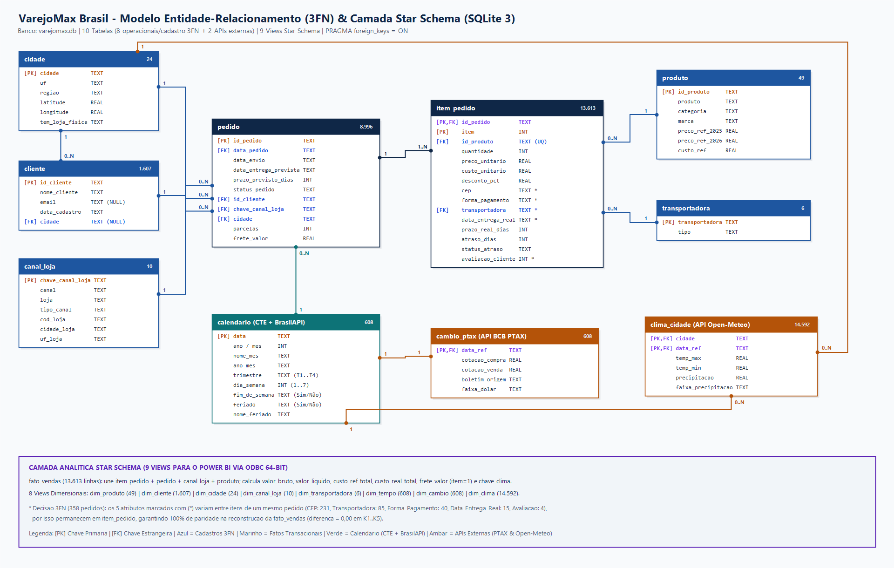

# Modelagem Relacional 3FN e Camada Analítica Star Schema — VarejoMax Brasil

> **Banco:** `varejomax.db` (SQLite 3, `PRAGMA foreign_keys = ON`)  
> **Escopo:** Etapa IV — Banco de Dados Relacional 3FN, Integração de APIs Externas e Views Star Schema para Power BI (ODBC 64-bit).

---

## 1. Arquitetura em Camadas

O banco `varejomax.db` organiza os dados em três camadas lógicas:

1. **Staging (`stg_*`, 9 tabelas `TEXT`):** recebe os 6 CSVs tratados da Etapa 2 (`dCidade`, `dCanalLoja`, `dProduto`, `dCliente`, `dTransportadora`, `fVendas`) e os 3 CSVs das APIs públicas (`cambio_ptax_2025_2026`, `clima_24_cidades_2025_2026`, `feriados_nacionais_2025_2026`).
2. **Camada Relacional 3FN + APIs (10 tabelas físicas):** aplica tipos fortes, chaves primárias (`pk_*`), chaves estrangeiras (`fk_*`), restrições de domínio (`ck_*`), unicidade (`uq_*`) e índices (`ix_*`).
3. **Camada Analítica Star Schema (9 Views):** expõe `fato_vendas` e 8 views dimensionais (`dim_*`) com nomes e ordem de colunas 100% aderentes aos scripts `.pq` de `04-powerbi-dashboard/m/`.

---

## 2. Decisões de Normalização 3FN e Casos de Borda

### 2.1 Separação `pedido` × `item_pedido` e os 358 pedidos com variação entre itens
Na auditoria de `fVendas.csv` (13.613 itens em 8.996 pedidos), verificou-se que:
- **Atributos invariantes no pedido** (`0` conflitos entre itens do mesmo `id_pedido`): `data_pedido`, `data_envio`, `data_entrega_prevista`, `prazo_previsto_dias`, `status_pedido`, `id_cliente`, `chave_canal_loja`, `cidade`, `parcelas`.
- **`frete_valor`:** ocorre exclusivamente em `item = 1` (`0` ocorrências de `frete_valor > 0` para `item <> 1`), sendo armazenado no cabeçalho `pedido` e exposto na view `fato_vendas` apenas quando `i.item = 1` (`CASE WHEN i.item = 1 THEN p.frete_valor ELSE 0.0 END`) para eliminar dupla contagem.
- **5 atributos com variação entre itens em 358 pedidos distintos:** `CEP` (231 pedidos), `Transportadora` (85 pedidos), `Forma_Pagamento` (40 pedidos), `Data_Entrega_Real` (15 pedidos) e `Avaliacao_Cliente` (4 pedidos). Para evitar falhas de unicidade e garantir reconstrução bit-a-bit da `fato_vendas` (diferença `0,00` em `K1`), esses 5 atributos — acompanhados de `prazo_real_dias`, `atraso_dias` e `status_atraso` — permanecem em `item_pedido` (PK composta `(id_pedido, item)` e `UNIQUE (id_pedido, id_produto)`).

### 2.2 Integridade Referencial e Restrições `CHECK`
- **`cliente.cidade` anulável:** `dCliente.csv` possui 1 registro administrativo (`C99999` — `Teste Interno`) com `Cidade`, `UF` e `Regiao` vazios; `varejomax_carga.sql` converte `''` para `NULL` via `NULLIF(TRIM(...), '')`, satisfazendo `fk_cliente_cidade`.
- **Datas fora da janela do calendário (`2025-01-01` a `2026-08-31`):** há 151 linhas de pedido cuja `data_entrega_prevista` se estende até `2026-09-11`. Por esse motivo, apenas `pedido.data_pedido`, `cambio_ptax.data_ref` e `clima_cidade.data_ref` possuem FK para `calendario(data)`.
- **Preservação de anomalias auditadas na Etapa 2:** `item_pedido` não impõe `CHECK (avaliacao_cliente BETWEEN 1 AND 5)` (há 8 notas fora da escala: `0` e `6..10`) nem `CHECK (data_entrega_real >= data_envio)` (há 18 itens marcados como `status_atraso = 'Inconsistente'`), preservando o batimento exato com a N1 (`13.613` linhas) e aplicando o filtro sanitizador nas consultas `C1`–`C10` e medidas DAX.
- **Calendário `Sim`/`Não`:** `calendario.fim_de_semana` e `calendario.feriado` utilizam `TEXT CHECK (... IN ('Sim', 'Não'))`, aderentes a `dim_tempo.pq`.
- **Arredondamento financeiro comercial:** na view `fato_vendas`, `valor_bruto`, `valor_liquido`, `custo_ref_total` e `custo_real_total` aplicam `ROUND(... + 1e-9, 2)` para neutralizar desvios binários IEEE-754 em metades exatas (`x.xx5`), garantindo diferença `0,00` contra `fVendas.csv` (`R$ 3.448.872,47`).

---

## 3. Dicionário de Tabelas (Camada Física)

| Tabela | Tipo | PK | FKs | Linhas | Descrição |
|---|---|---|---|---:|---|
| `cidade` | Dimensão 3FN | `cidade` | — | 24 | Municípios atendidos, UF, região, lat/long e flag `tem_loja_fisica` |
| `canal_loja` | Dimensão 3FN | `chave_canal_loja` | — | 10 | Canais (`Site`, `App`, `Marketplace`, `Loja Física`) e 7 lojas físicas |
| `produto` | Dimensão 3FN | `id_produto` | — | 49 | Catálogo em 6 categorias (`CHECK`), marca, preços ref. 2025/2026 e `custo_ref` |
| `cliente` | Dimensão 3FN | `id_cliente` | `cidade -> cidade` (nullable) | 1.607 | Cadastro de clientes (`email` e `cidade` aceitam `NULL`) |
| `transportadora` | Dimensão 3FN | `transportadora` | — | 6 | Parceiros logísticos, retirada em loja e não informado |
| `calendario` | Dimensão Temporal | `data` | — | 608 | Série contínua `2025-01-01`..`2026-08-31` gerada por CTE recursiva + 22 feriados BrasilAPI |
| `pedido` | Fato Cabeçalho | `id_pedido` | `data_pedido`, `id_cliente`, `chave_canal_loja`, `cidade` | 8.996 | Cabeçalho do pedido, datas logísticas previstas, status, parcelas e frete |
| `item_pedido` | Fato Item | `(id_pedido, item)` | `id_pedido`, `id_produto`, `transportadora` | 13.613 | Grão analítico do item, preços, custos, descontos, entrega real e avaliação |
| `cambio_ptax` | API Externa | `data_ref` | `data_ref -> calendario` | 608 | Cotação diária USD/BRL PTAX (BCB Olinda) com carry-forward |
| `clima_cidade` | API Externa | `(cidade, data_ref)` | `cidade -> cidade`, `data_ref -> calendario` | 14.592 | Temperatura máx/mín, precipitação (mm) e `faixa_precipitacao` (24 × 608) |

---

## 4. Índices Criados (`varejomax_ddl.sql`)

| Índice | Tabela(Colunas) | Finalidade |
|---|---|---|
| `ix_pedido_data` | `pedido(data_pedido)` | Filtros temporais e joins com `calendario` / `cambio_ptax` |
| `ix_pedido_cliente` | `pedido(id_cliente)` | RFV, recompra e joins com `cliente` |
| `ix_pedido_canal_loja` | `pedido(chave_canal_loja)` | Agregações por canal e loja |
| `ix_pedido_cidade` | `pedido(cidade)` | Análise regional e cruzamento geográfico |
| `ix_pedido_status` | `pedido(status_pedido)` | Filtro rápido de pedidos válidos/entregues (`C5`, `C6`) |
| `ix_item_pedido_produto` | `item_pedido(id_produto)` | Mix por categoria/produto (`C2`, `C8`, `C9`) |
| `ix_item_pedido_transp` | `item_pedido(transportadora)` | SLA e auditoria logística (`C5`, `C6`) |
| `ix_clima_cidade_data` | `clima_cidade(data_ref)` | Varredura temporal de clima |
| `ix_calendario_ano_mes` | `calendario(ano_mes)` | Agregação mensal MoM (`C1`) |

---

## 5. Contrato das 9 Views Star Schema (`varejomax_views.sql`)

| View | Linhas | Chave de Ligação no Power BI | Observações de Contrato (`.pq`) |
|---|---:|---|---|
| `dim_produto` | 49 | `id_produto` | `id_produto, produto, categoria, marca, preco_ref_2025, preco_ref_2026, custo_ref` |
| `dim_cliente` | 1.607 | `id_cliente` | `LEFT JOIN cidade` para enriquecer `uf` e `regiao` mantendo `C99999` |
| `dim_cidade` | 24 | `cidade` | `cidade, uf, regiao, latitude, longitude, tem_loja_fisica` |
| `dim_canal_loja` | 10 | `chave_canal_loja` | `chave_canal_loja, canal, loja, tipo_canal, cod_loja, cidade_loja, uf_loja` |
| `dim_transportadora` | 6 | `transportadora` | `transportadora, tipo` |
| `dim_tempo` | 608 | `data` | `fim_de_semana` e `feriado` em `'Sim'`/`'Não'`, `nome_feriado` |
| `dim_cambio` | 608 | `data` (`data_ref AS data`) | `data, cotacao_compra, cotacao_venda, boletim_origem, faixa_dolar` |
| `dim_clima` | 14.592 | `chave_clima` (`cidade \|\| '\|' \|\| data_ref`) | `chave_clima, cidade, data, temp_max, temp_min, precipitacao, faixa_precipitacao` |
| `fato_vendas` | 13.613 | FKs acima + `chave_clima` | 32 colunas exatas esperadas por `fato_vendas.pq`; `frete_valor` só no `item = 1` |
