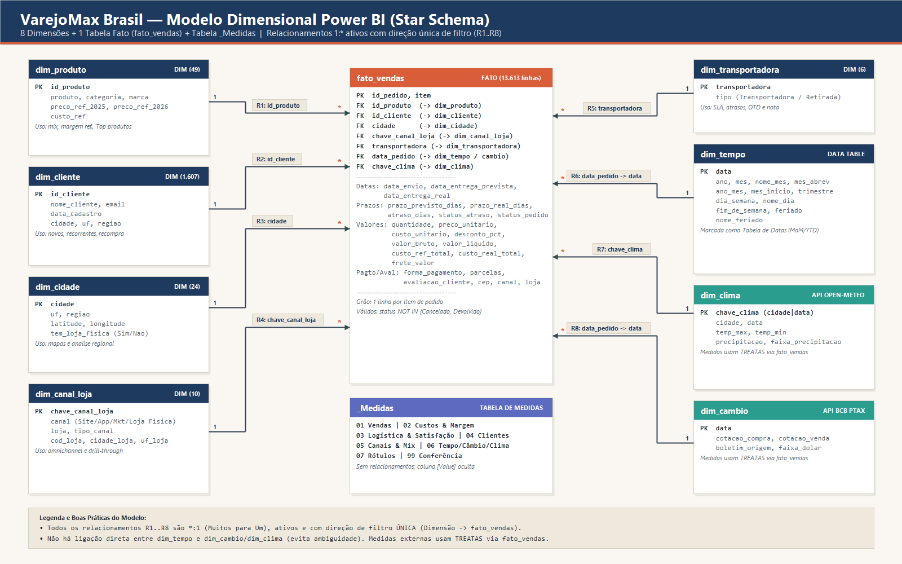

# Documentação do Modelo Semântico Power BI — VarejoMax Brasil

> **Camada:** `04-powerbi-dashboard/`  
> **Origem dos dados:** Banco SQLite `varejomax.db` via conector ODBC (DSN `varejomax`)  
> **Diagrama visual:** [diagrama_modelo.png](diagrama_modelo.png)

---

## 1. Visão Geral da Arquitetura

O modelo semântico segue o padrão **Star Schema** com enriquecimento externo:

- **1 tabela fato (`fato_vendas`)**: grão de **1 linha por item de pedido** (`id_pedido` + `item`), totalizando `13.613` linhas (`8.996` pedidos totais; `8.291` pedidos válidos).
- **8 tabelas dimensão**:
  - 5 dimensões de negócio internas: `dim_produto`, `dim_cliente`, `dim_cidade`, `dim_canal_loja`, `dim_transportadora`.
  - 1 dimensão calendário oficial: `dim_tempo` (marcada como **Tabela de Datas** na coluna `data`).
  - 2 dimensões de enriquecimento via APIs REST: `dim_cambio` (BCB PTAX) e `dim_clima` (Open-Meteo).
- **1 tabela dedicada de medidas (`_Medidas`)**: tabela calculada isolada (`_Medidas = { BLANK() }`, coluna `[Value]` oculta), organizada em **8 pastas de exibição**.

---

## 2. Contrato de Tabelas e Colunas (Views SQL → Power Query M)

Todas as consultas M em [m/](../m/) leem as views canônicas de `varejomax.db` usando `Odbc.Query(pConexaoODBC, ...)` e convertem os tipos explicitamente com cultura `"en-US"` (prevenindo erros de separador decimal `.` vs `,` em Windows `pt-BR`).

| Tabela | Tipo | Chave Primária | Colunas |
|---|---|---|---|
| `fato_vendas` | Fato | `id_pedido`, `item` | `id_pedido, item, data_pedido, data_envio, data_entrega_prevista, data_entrega_real, prazo_previsto_dias, prazo_real_dias, atraso_dias, status_atraso, status_pedido, canal, loja, chave_canal_loja, id_cliente, cidade, cep, id_produto, quantidade, preco_unitario, custo_unitario, desconto_pct, valor_bruto, valor_liquido, custo_ref_total, custo_real_total, frete_valor, forma_pagamento, parcelas, transportadora, avaliacao_cliente, chave_clima` |
| `dim_produto` | Dimensão | `id_produto` | `id_produto, produto, categoria, marca, preco_ref_2025, preco_ref_2026, custo_ref` |
| `dim_cliente` | Dimensão | `id_cliente` | `id_cliente, nome_cliente, email, data_cadastro, cidade, uf, regiao` |
| `dim_cidade` | Dimensão | `cidade` | `cidade, uf, regiao, latitude, longitude, tem_loja_fisica` |
| `dim_canal_loja` | Dimensão | `chave_canal_loja` | `chave_canal_loja, canal, loja, tipo_canal, cod_loja, cidade_loja, uf_loja` |
| `dim_transportadora` | Dimensão | `transportadora` | `transportadora, tipo` |
| `dim_tempo` | Calendário | `data` | `data, ano, mes, nome_mes, mes_abrev, ano_mes, mes_inicio, trimestre, dia_semana, nome_dia, fim_de_semana, feriado, nome_feriado` |
| `dim_cambio` | Externa (BCB) | `data` | `data, cotacao_compra, cotacao_venda, boletim_origem, faixa_dolar` |
| `dim_clima` | Externa (Open-Meteo) | `chave_clima` | `chave_clima, cidade, data, temp_max, temp_min, precipitacao, faixa_precipitacao` |

> **Nota:** `tst_Conexao.pq` permanece com *Habilitar Carga = Desabilitado* e serve exclusivamente para diagnosticar a versão do SQLite (`sqlite_version()`) e a contagem das views no Power Query.

---

## 3. Relacionamentos e Propagação de Filtros

Todos os 8 relacionamentos são **`*:1` (Muitos para Um)**, **ativos** e com **direção de filtro única** (`Dimensão → fato_vendas`):

| ID | Origem (`fato_vendas`) | Destino (Dimensão) | Cardinalidade | Direção |
|---|---|---|---|---|
| **R1** | `fato_vendas[id_produto]` | `dim_produto[id_produto]` | `*:1` | Única |
| **R2** | `fato_vendas[id_cliente]` | `dim_cliente[id_cliente]` | `*:1` | Única |
| **R3** | `fato_vendas[cidade]` | `dim_cidade[cidade]` | `*:1` | Única |
| **R4** | `fato_vendas[chave_canal_loja]` | `dim_canal_loja[chave_canal_loja]` | `*:1` | Única |
| **R5** | `fato_vendas[transportadora]` | `dim_transportadora[transportadora]` | `*:1` | Única |
| **R6** | `fato_vendas[data_pedido]` | `dim_tempo[data]` | `*:1` | Única |
| **R7** | `fato_vendas[chave_clima]` | `dim_clima[chave_clima]` | `*:1` | Única |
| **R8** | `fato_vendas[data_pedido]` | `dim_cambio[data]` | `*:1` | Única |

### Por que não ligar `dim_cambio` ou `dim_clima` diretamente a `dim_tempo` ou `dim_cidade`?
Se houvesse relacionamento direto entre `dim_tempo[data]` → `dim_cambio[data]` ou `dim_cidade[cidade]` → `dim_clima[cidade]` simultaneamente a `R6`/`R7`/`R8`, o modelo criaria **caminhos ambíguos** no grafo de filtros.  
Para garantir que filtros aplicados pelo usuário em `dim_tempo` (ano, mês) ou `dim_cidade` (cidade, região) propaguem corretamente para as métricas externas, as medidas `[Dólar PTAX Médio]`, `[Temp Máx Média]`, `[Temp Mín Média]` e `[Precipitação Média mm]` utilizam **`TREATAS`** sobre `VALUES(fato_vendas[data_pedido])` e `VALUES(fato_vendas[chave_clima])`.

---

## 4. Configurações Semânticas Obrigatórias

### 4.1 Tabela de Datas e Ordenação de Colunas
- Marcar `dim_tempo` como **Tabela de Datas** utilizando a coluna `dim_tempo[data]`.
- Configurar **Classificar por Coluna (Sort by Column)**:
  - `dim_tempo[nome_mes]` → classificar por `dim_tempo[mes]`
  - `dim_tempo[mes_abrev]` → classificar por `dim_tempo[mes]`
  - `dim_tempo[ano_mes]` → classificar por `dim_tempo[mes_inicio]`
  - `dim_tempo[nome_dia]` → classificar por `dim_tempo[dia_semana]`

### 4.2 Categorias de Dados (Geografia e Web)
- `dim_cidade[cidade]`, `dim_cliente[cidade]` → **Cidade**
- `dim_cidade[uf]`, `dim_cliente[uf]` → **Estado ou Província**
- `dim_cidade[latitude]` → **Latitude** (Resumo: *Não resumir*)
- `dim_cidade[longitude]` → **Longitude** (Resumo: *Não resumir*)
- `fato_vendas[cep]` → **Código Postal** (Texto)

### 4.3 Colunas Ocultas na Visão de Relatório
Para evitar uso acidental de somas brutas sem regra de negócio:
- Ocultar `_Medidas[Value]`.
- Em `fato_vendas`, ocultar chaves estrangeiras (`id_produto`, `id_cliente`, `chave_canal_loja`, `chave_clima`) e colunas redundantes com as dimensões (`canal`, `loja` na fato) — manter `status_pedido`, `status_atraso` e `forma_pagamento` visíveis para segmentações e matrizes.

---

## 5. Regras de Negócio e Dicionário de Medidas (`_Medidas`)

Arquivo completo: [medidas_finais.dax](../dax/medidas_finais.dax)

| Pasta | Medida | Regra de Negócio / Fórmula Resumida | Referência Esperada |
|---|---|---|---|
| `01 Vendas` | `[Faturamento Bruto]` | `SUMX` de `ROUND(quantidade * preco_unitario, 2)` onde `status_pedido <> "Cancelado"` | `R$ 3.797.167,40` |
| `01 Vendas` | `[Faturamento]` | `SUMX` de `ROUND(quantidade * preco_unitario * (1 - desconto_pct), 2)` onde `status_pedido NOT IN {"Cancelado", "Devolvido"}` | `R$ 3.448.872,47` |
| `01 Vendas` | `[Qtd Pedidos]` | `DISTINCTCOUNT(id_pedido)` em pedidos válidos (`NOT IN {"Cancelado", "Devolvido"}`) | `8.291` |
| `01 Vendas` | `[Qtd Pedidos Total]` | `DISTINCTCOUNT(id_pedido)` sem filtro de status | `8.996` |
| `01 Vendas` | `[Ticket Médio]` | `DIVIDE([Faturamento], [Qtd Pedidos])` | `R$ 415,98` |
| `01 Vendas` | `[Qtd Itens]` | `SUM(quantidade)` em pedidos válidos | `16.581` |
| `01 Vendas` | `[Itens por Pedido]` | `DIVIDE([Qtd Itens], [Qtd Pedidos])` | `2,00` |
| `01 Vendas` | `[Frete Total]` | `SUM(frete_valor)` (lançado no item 1 de cada pedido) | `R$ 97.922,36` |
| `02 Custos & Margem` | `[Custo Total]` | `SUMX(quantidade * RELATED(dim_produto[custo_ref]))` em pedidos válidos | `R$ 2.372.700,48` |
| `02 Custos & Margem` | `[Lucro Bruto]` | `[Faturamento] - [Custo Total]` | `R$ 1.076.171,99` |
| `02 Custos & Margem` | `[Margem Bruta %]` | `DIVIDE([Lucro Bruto], [Faturamento])` | `31,2%` |
| `02 Custos & Margem` | `[Custo Realizado]` | `SUMX(quantidade * custo_unitario)` em pedidos válidos | `R$ 2.402.823,74` |
| `02 Custos & Margem` | `[Margem Realizada %]` | `DIVIDE([Faturamento] - [Custo Realizado], [Faturamento])` | `30,3%` |
| `03 Logística & Satisfação` | `[Qtd Pedidos Atrasados]` | `DISTINCTCOUNT(id_pedido)` com `status_atraso = "Atrasado"` em pedidos válidos | `628` |
| `03 Logística & Satisfação` | `[% Pedidos Atrasados]` | `DIVIDE([Qtd Pedidos Atrasados], [Qtd Pedidos])` | `7,6%` |
| `03 Logística & Satisfação` | `[Nota Média Cliente]` | `AVERAGE(avaliacao_cliente)` filtrando `1 <= avaliacao_cliente <= 5` (descarta 8 notas inválidas `0` e `6..10`) | `4,11` |
| `04 Clientes` | `[Clientes Ativos]` | Clientes com `>= 1` pedido válido no contexto | `1.571` |
| `04 Clientes` | `[Clientes Novos]` | Clientes com `= 1` pedido válido no contexto | `449` |
| `04 Clientes` | `[Clientes Recorrentes]` | Clientes com `>= 2` pedidos válidos no contexto | `1.122` |
| `04 Clientes` | `[% Taxa Recompra]` | `DIVIDE([Clientes Recorrentes], [Clientes Ativos])` | `71,4%` |
| `05 Canais & Mix` | `[Faturamento Online]` / `[Loja Física]` / `[% Share ...]` / `[Ranking Produto Faturamento]` | Participação por canal (`Online (e-commerce)` vs `Loja física`), categoria, pagamento (`Pix`, parcelas) | — |
| `06 Tempo, Câmbio & Clima` | `[Faturamento Mês Anterior (MoM)]`, `[YoY]`, `[YTD]`, `[Dólar PTAX Médio]`, `[Temp Máx Média]`, `[Precipitação Média mm]` | Inteligência temporal (`DATEADD`, `TOTALYTD`) e propagação externa via `TREATAS` | — |
| `07 Rótulos` | `[Título Dinâmico Período]`, `[Subtítulo Filtros Ativos]`, `[Rótulo MoM Faturamento]`, `[Cor Status Atraso]`, `[Cor Margem Bruta]` | Títulos dinâmicos e formatação condicional hexadecimal | — |
| `99 Conferência` | `[Conf Linhas Fato]`, `[Conf Avaliações Inválidas]`, `[Conf Diferença ...]`, `[Conf Pedidos Sem Clima]` | Auditoria automatizada exibida na página oculta `Conferência` | `13.613` / `8` / `0` |
