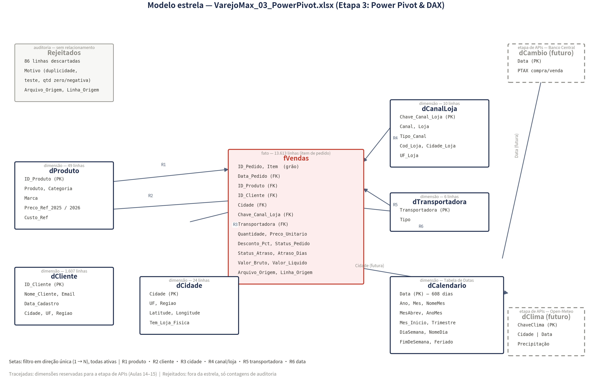

# Modelo relacional — VarejoMax_03_PowerPivot.xlsx

Origem dos dados: `MA2026-entrega-parcial/02-powerquery/VarejoMax_02_PowerQuery_VIVO.xlsx`
(parâmetro `pArquivoEtapa2`). Nenhum dado é digitado nesta etapa — tudo vem da Etapa 2
ou é gerado (dCalendario). Os arquivos das etapas 1 e 2 **não foram alterados**.

## Tabelas

| Tabela | Tipo | Grão (1 linha =) | Chave primária | Linhas |
|---|---|---|---|---|
| fVendas | fato | item de pedido aceito (ID_Pedido + Item) | — (FKs: Data_Pedido, ID_Produto, ID_Cliente, Cidade, Chave_Canal_Loja, Transportadora) | 13,613 |
| dProduto | dimensão | produto do catálogo | ID_Produto | 49 |
| dCliente | dimensão | cliente | ID_Cliente | 1,607 |
| dCidade | dimensão | cidade de entrega | Cidade | 24 |
| dCanalLoja | dimensão | canal × loja | Chave_Canal_Loja | 10 |
| dTransportadora | dimensão | transportadora | Transportadora | 6 |
| dCalendario | dimensão | dia (01/01/2025 a 31/08/2026, contínua) | Data | 608 |
| Rejeitados | auditoria | linha bruta descartada | — | 86 |

O modelo CaféData usa dFilial; no VarejoMax a dimensão de "onde" se desdobra em
**dCidade** (destino do pedido) e **dCanalLoja** (onde a venda aconteceu), e o custo
vem do cadastro em **dProduto[Custo_Ref]** — mesma função, anatomia adaptada ao tema.

## Relacionamentos (todos ativos, N:1, filtro em direção única)

| # | Lado N (FK) | Lado 1 (PK) | Sentido do filtro |
|---|---|---|---|
| R1 | fVendas[ID_Produto] | dProduto[ID_Produto] | dProduto filtra fVendas |
| R2 | fVendas[ID_Cliente] | dCliente[ID_Cliente] | dCliente filtra fVendas |
| R3 | fVendas[Cidade] | dCidade[Cidade] | dCidade filtra fVendas |
| R4 | fVendas[Chave_Canal_Loja] | dCanalLoja[Chave_Canal_Loja] | dCanalLoja filtra fVendas |
| R5 | fVendas[Transportadora] | dTransportadora[Transportadora] | dTransportadora filtra fVendas |
| R6 | fVendas[Data_Pedido] | dCalendario[Data] | dCalendario filtra fVendas |

dCalendario marcada como **Tabela de Datas** (coluna `Data`) — habilita DATEADD/TOTALMTD
usados em [Cresc. MoM %]. NomeMes ordenado por Mes; NomeDia por DiaSemana
(Classificar por Coluna).

Previsto para a etapa de APIs (Aulas 14–15): dCambio (Banco Central/PTAX, ligada por
dCalendario[Data]) e dClima (Open-Meteo, ChaveClima = Cidade & "|" & Data, ligada a
dCidade e dCalendario) — caixas tracejadas no diagrama.

## Regras de negócio aplicadas às medidas (decisões da equipe, documentadas)

- **Faturamento exclui Cancelados e Devolvidos** (premissa da proposta técnica: pedidos
  cancelados não faturam; devoluções são analisadas à parte). Em trânsito e Em separação
  **entram** (venda realizada). É a mesma regra da aba Conferencia da Etapa 2
  (SUMIFS com "<>Cancelado" e "<>Devolvido").
- **Faturamento Bruto exclui apenas Cancelados** (o devolvido chegou a ser faturado; o
  bruto mede o desconto concedido) — espelha o SUMIFS da Etapa 2 para Valor_Bruto.
- **Custo Total usa o Custo_Ref do cadastro** (RELATED dProduto[Custo_Ref]), como o
  CaféData usa o Custo do cadastro. A complementar [Custo Realizado] usa o custo
  praticado por venda (em 2026 há reajuste: margem realizada 30,3% vs referência 31,2%).

## Integridade apurada (aba Conferencia)

| Verificação | Resultado |
|---|---|
| Linhas lidas = aceitas + rejeitadas | 13,699 = 13,613 + 86 ✓ |
| [Faturamento] vs soma Valor_Liquido da Etapa 2 | 3,448,872.47 = 3.448.872,47 (dif 0) ✓ |
| [Faturamento Bruto] vs soma Valor_Bruto (sem cancelados) | 3,797,167.40 ✓ |
| FKs órfãs (5 dimensões) | 0 ✓ |
| PKs duplicadas (6 tabelas) | 0 ✓ |
| Vendas fora do calendário | 0 ✓ |

